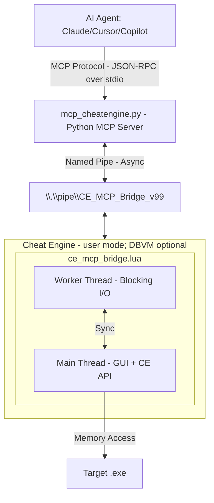

[Demo](https://github.com/user-attachments/assets/a184a006-f569-4b55-858a-ed80a7139035)

# Cheat Engine MCP Bridge

**Let multibillion $ AI datacenters analyze the program memory for you.**

Create mods, trainers, security audits, game bots, accelerate RE, or do anything else with any program and game in a fraction of a time.

[](#) [](https://python.org)

> [!NOTE]
> Enhanced standalone edition derived from [miscusi-peek/cheatengine-mcp-bridge](https://github.com/miscusi-peek/cheatengine-mcp-bridge) (MIT License). Major additions include threaded FastMCP pipe isolation, automatic idle pipe release & CE watchdog, unified request deadlines without replaying ambiguous writes, hot-reloadable Lua dispatcher, bounded conditional hardware breakpoints, 18s x64 region-cache optimization, hardened AOB/DBVM/stack capture paths, standalone `check_pipe.py` diagnostics, and offline Lua/Python regression suites.

---

## The Problem

You're staring at gigabytes of memory. Millions of addresses. Thousands of functions. Finding *that one pointer*, *that one structure* takes **days or weeks** of manual work.

**What if you could just ask?**

> *"Find the packet decryptor hook."*  
> *"Find the OPcode of character coordinates."*  
> *"Find the OPcode of health values."*  
> *"Find the unique AOB pattern to make my trainer reliable after game updates."*

**That's exactly what this does.**

_- Stop clicking through hex dumps and start having conversations with the memory._

---

## What You Get:

| Before (Manual) | After (AI Agent + MCP) |
|-----------------|---------------------|
| Day 1: Find packet address | Minute 1: "Find RX packet decryption hook" |
| Day 2: Trace what writes to it | Minute 3: "Generate unique AOB signature to make it update persistent" |
| Day 3: Find RX hook | Minute 6: "Find movement OPcodes" |
| Day 4: Document structure | Minute 10: "Create python interpreter of hex to plain text" |
| Day 5: Game updates, start over | **Done.** |

**Your AI can now:**
- Read any memory instantly (integers, floats, strings, pointers)
- Follow pointer chains: `[[base+0x10]+0x20]+0x8` → resolved in ms
- Auto-analyze structures with field types and values
- Identify C++ objects via RTTI: *"This is a CPlayer object"*
- Disassemble and analyze functions
- Collect bounded hardware-breakpoint samples, with optional Ring -1 watches
- And much more!

---

## How It Works

---

## Installation

```bash
pip install -r MCP_Server/requirements.txt
```
Or manually:
```bash
pip install "mcp>=1.2.0,<2.0" pywin32
```

> [!NOTE]
> **Windows only** - Uses Named Pipes (`pywin32`)

---

## Quick Start

### 1. Load Bridge in Cheat Engine
```
1. File → Execute Script → Open ce_mcp_bridge.lua → Execute.
2. Enable DBVM only if you explicitly need the `*_dbvm_watch` tools.
```
Look for: `[MCP v11.6.3] MCP Server Listening on: CE_MCP_Bridge_v99`

The worker resolves a global command dispatcher for each request. Re-running the
script hot-swaps handlers without stopping the connected pipe worker. A pre-11.6.2
legacy worker cannot hot-swap safely; restart CE once, load v11.6.3, and later script
updates will apply in place.

### 2. Configure MCP Client
Add to your MCP configuration (e.g., `mcp_config.json`):
```json
{
  "servers": {
    "cheatengine": {
      "command": "python",
      "args": ["C:/path/to/MCP_Server/mcp_cheatengine.py"]
    }
  }
}
```
Restart the IDE to load the MCP server config.

### Optional Environment Overrides
If you run multiple bridge instances or need longer startup windows, the Python side now honors these environment variables:

```powershell
$env:CE_MCP_PIPE_NAME="CE_MCP_Bridge_v99"
$env:CE_MCP_SERVER_NAME="cheatengine"
$env:CE_MCP_TIMEOUT_MS="120000"
$env:CE_MCP_CONNECT_WAIT_MS="3000"
$env:CE_MCP_CONNECT_RETRIES="3"
$env:CE_MCP_CONNECT_RETRY_DELAY_MS="250"
```

- `CE_MCP_PIPE_NAME`: short pipe name or full `\\.\pipe\...` path
- `CE_MCP_SERVER_NAME`: override the FastMCP server name exposed to your IDE
- `CE_MCP_TIMEOUT_MS`: default total pipe request budget, shared by the queue, connection, I/O and safe retries (default 120000 ms). An explicit tool timeout overrides this budget.
- `CE_MCP_CONNECT_WAIT_MS` × `CE_MCP_CONNECT_RETRIES`: cap on each connection attempt (default 9 s), limited by the remaining request budget
- `CE_MCP_CONNECT_RETRY_DELAY_MS`: delay between connection retries for unexpected errors
- `CE_MCP_PIPE_MISSING_GRACE_MS`: how long to wait when the pipe does not exist at all (default 1000 ms, so a missing CE fails fast)
- `CE_MCP_IDLE_DISCONNECT_MS`: release the pipe after this much inactivity (default 3000 ms; `0` = after every command, negative = never)
- `CE_MCP_MAX_RESPONSE_BYTES`: hard cap on a single CE response (default 64 MB)
- `CE_MCP_MAX_LOCAL_FILE_BYTES`: hard cap on local files loaded by `evaluate_lua_file`, `auto_assemble_file`, and `check_pipe.py --lua-file` (default 16 MB, minimum 1 MB)
- `CE_MCP_AUTH_TOKEN`: optional shared-secret token sent on every pipe request (for shared Windows hosts; see **Security & Local Pipe Trust Boundary** below)

#### Security & Local Pipe Trust Boundary
Cheat Engine's built-in `createPipe()` creates a local Windows Named Pipe without a custom user ACL, so on a multi-user or shared Windows host another local account could connect to the pipe and execute Lua inside Cheat Engine. To protect shared hosts, set a shared secret on **both** sides before executing the bridge script:

In Cheat Engine's Lua console:
```lua
CE_MCP_AUTH_TOKEN = "replace-with-a-random-secret"
```

And in your MCP server environment (and when running `check_pipe.py --auth-token ...` or setting `CE_MCP_AUTH_TOKEN`):
```powershell
$env:CE_MCP_AUTH_TOKEN="replace-with-a-random-secret"
```

When configured, `ce_mcp_bridge.lua` rejects requests missing a matching `auth_token` with JSON-RPC error `-32001` (`Unauthorized`), and `status` reports `auth_required: true` without exposing the token. `check_pipe.py` shares the same local pipe trust boundary and honors `CE_MCP_AUTH_TOKEN` / `--auth-token`.

#### One client at a time
The CE bridge serves a single pipe client. Every AI session (Claude Code, Codex,
Cursor…) starts its own `mcp_cheatengine.py`, so an idle session that kept its handle
open used to lock all the others out ("all pipe instances are busy"). Two layers now
prevent that without anyone calling `disconnect`:

1. The Python client drops its handle after `CE_MCP_IDLE_DISCONNECT_MS` of inactivity
   and reconnects transparently on the next tool call.
2. The Lua bridge disconnects any client that has sent nothing for 60 s — a safety
   net for old clients or stuck processes. Change it with `CE_MCP_IDLE_KICK_MS = 120000`
   (or `0` to disable) in CE's Lua console before executing the script.

To pair a second CE instance with its own pipe, set the name on **both** sides — in
CE's Lua console before executing the bridge script:

```lua
CE_MCP_PIPE_NAME = "CE_MCP_Bridge_alt"
```

and on the MCP server with `--pipe CE_MCP_Bridge_alt` or `CE_MCP_PIPE_NAME`.

### 3. Verify Connection
Use the `ping` tool to verify connectivity:
```json
{"success": true, "version": "11.6.3", "message": "CE MCP Bridge v11.6.3 alive"}
```

For a fuller picture — attached process, architecture, DBK/DBVM availability, live
breakpoints, DBVM watches — use the `status` tool. It is the right first call when
something misbehaves.

### 4. Start Asking Questions
```
"What process is attached?"
"Read 16 bytes at the base address"
"Disassemble the entry point"
"Run my local Lua helper with evaluate_lua_file"
"Apply my local AutoAssembler patch with auto_assemble_file"
```

### 5. Run Local Files Through MCP
You can now execute local script files directly from the Python MCP layer without copy-pasting them into chat:

```text
evaluate_lua_file(file_path="C:/path/to/helper.lua", structured=true)
auto_assemble_file(file_path="C:/path/to/patch.cea")
```

- `evaluate_lua_file` auto-detects common encodings including UTF-8 and GB-family encodings
- `auto_assemble_file` is useful for local `.CEA` / AutoAssembler payloads
- Both tools return `source_file`, `source_encoding`, and `source_length` metadata for traceability

For low-level pipe troubleshooting outside the IDE, `check_pipe.py` talks to CE
directly — no MCP SDK, no AI client — which separates a broken bridge from a broken
MCP setup. It uses overlapped pipe I/O, honors `CE_MCP_PIPE_NAME` (overridden by
`--pipe`) and `CE_MCP_MAX_LOCAL_FILE_BYTES`, accepts `--timeout-ms` (default
15000 ms, minimum 1000 ms), and prints a checklist instead of a bare OS error on a
connection failure.

```bash
python MCP_Server/check_pipe.py --summary
```

```bash
python MCP_Server/check_pipe.py --ping --repeat 5 --timeout-ms 30000
```

```bash
python MCP_Server/check_pipe.py --lua-file "C:/path/to/helper.lua"
```

---

## 48 MCP Tools Available

### Memory
| Tool | Description |
|------|-------------|
| `read_memory`, `read_integer`, `read_string` | Read any data type |
| `read_pointer_chain` | Follow `[[base+0x10]+0x20]` paths |
| `scan_all`, `aob_scan` | Find values and byte patterns |
| `get_memory_regions`, `enum_memory_regions_full` | Enumerate memory regions (pass `refresh=True` after target allocations change) |

### Analysis
| Tool | Description |
|------|-------------|
| `disassemble`, `analyze_function` | Code analysis |
| `dissect_structure` | Auto-detect fields and types |
| `get_rtti_classname` | Identify C++ object types |
| `find_references`, `find_call_references` | Cross-references |

### Debugging
| Tool | Description |
|------|-------------|
| `set_breakpoint`, `set_data_breakpoint` | Hardware breakpoints |
| `start_dbvm_watch`, `poll_dbvm_watch`, `stop_dbvm_watch` | Ring -1 invisible tracing |

### Bridge control
| Tool | Description |
|------|-------------|
| `status` | Attached process, DBK/DBVM state, live breakpoints and watches |
| `cleanup` | Drop all breakpoints, watches and scan objects without reloading the script |
| `auto_assemble` | Run a script's `[ENABLE]` section, then revert it with `disable=True` |

And many more at `AI_Context/MCP_Bridge_Command_Reference.md`

### Scanning across more than one window

Every scan covers up to 200,000 addresses per window and returns
`next_start_address`. Rather than chaining calls yourself, raise `max_windows`
(up to 64) on `aob_scan`, `search_string` and `find_references` to walk several
consecutive regions in a single call — `time_budget_ms` still bounds the whole call.
Unbounded scans for low-entropy patterns are refused unless you pass
`allow_unsafe_global=True`.

### Safe breakpoint sampling

Before installing a breakpoint, attach to the target and start the debugger in CE
(for example, run `debugProcess()` directly in CE's Lua console). Finish any attach
dialog/wait there, then check `status.debugger_started`. This flag means the debugger
was started; it does not prove that the backend can successfully install a breakpoint.
The bridge verifies installation separately using CE's actual breakpoint list.

Since 11.6.3, execution/data breakpoints and their aliases refuse installation when
the debugger is not started or its state cannot be queried. CE's
[`debug_setBreakpoint` implementation](https://github.com/cheat-engine/cheat-engine/blob/master/Cheat%20Engine/LuaHandler.pas)
implicitly calls `StartDebuggerIfNeeded`; doing this inside the synchronous pipe
dispatch can stall the request during attachment. Do not start the debugger through
`evaluate_lua` to work around the check: that uses the same main-thread dispatch.

The Python MCP tools now run blocking pipe I/O in worker threads so a waiting CE
operation does not block the MCP protocol event loop. The single CE connection is
still serialized. A concurrent request waits at most `CE_MCP_LOCK_TIMEOUT_MS`
(default 15000 ms), or the remaining request budget if shorter, for the lock.
If it expires in the queue, nothing is sent.
Breakpoint installation uses `CE_MCP_BREAKPOINT_TIMEOUT_MS` (default 10000 ms) as
its total pipe request budget, with no automatic retry. A timeout cannot cancel CE's
native debugger operation: inspect CE and the breakpoint state before repeating a
request. Pending Windows I/O is cancelled and completed before its event and buffer
are released, so cleanup can finish after the request deadline. The MCP host can
impose a shorter timeout than the Python pipe client.

To apply the fix, restart the Python MCP server and load the updated Lua file in CE.
A responsive 11.6.2+ worker supports handler hot reload. If CE is already hung,
the new file cannot repair that running native call; recover/restart CE first.

Hardware breakpoints are not truly "non-breaking": CE briefly stops the triggering
thread, runs the Lua callback, and resumes it. A persistent breakpoint on a hot API
such as `WS2_32!send` can therefore starve CE's main thread and make the pipe appear
disconnected.

`set_breakpoint` and `set_data_breakpoint` now default to `one_shot=True` and
`max_triggers=256`. They also accept register and memory conditions, evaluated before
register or stack capture. For example:

```json
{
  "address": "module+offset",
  "id": "packet_once",
  "one_shot": true,
  "max_triggers": 256,
  "conditions": [
    {"kind": "register", "register": "R8", "operator": "in", "values": [42, 123, 387]},
    {"kind": "memory", "base_register": "RDX", "offset": 0, "size": 1, "operator": "eq", "value": 1}
  ]
}
```

All conditions are ANDed. Supported operators are `eq`, `ne`, `lt`, `le`, `gt`,
`ge`, `in`, and `mask_eq`. On the first matching hit, or when the trigger cap is
reached, the bridge removes the breakpoint and preserves its buffered result for
`get_breakpoint_hits`. Set `one_shot=False` and explicit limits only for known
low-frequency locations.

Regression checks (run from `MCP_Server`):

```powershell
python test_offline.py
python -m pytest test_server_threading.py test_check_pipe.py -v
```

These cover Lua preflight/lifecycle behavior, the installed FastMCP tool dispatcher,
bounded lock waits, non-retried breakpoint requests, and cancellation/recovery on an
isolated real Windows named pipe. They do not replace live CE debugger validation.

---

## Critical Configuration

### BSOD Prevention
> [!CAUTION]
> **You MUST disable:** Cheat Engine → Settings → Extra → **"Query memory region routines"**
> 
> Enabled: Causes `CLOCK_WATCHDOG_TIMEOUT` BSODs due to conflicts with DBVM/Anti-Cheat when scanning protected pages.

### Kernel/DBVM mode

The normal bridge, memory reads, scans, and bounded hardware breakpoints do not require
the kernel debugger or DBVM. Do not enable them merely to keep the MCP pipe alive:
they do not remove the per-hit Lua callback cost. Use DBVM only for an explicit
`start_dbvm_watch` workflow after `status` reports `dbk_loaded` and `dbvm_active`, and
test it in a disposable session because a driver or hypervisor failure can crash the
host.

---

## Example Workflows

**Finding a value:**
```
You: "Scan for gold: 15000"  →  AI finds 47 results
You: "Gold changed to 15100"  →  AI filters to 3 addresses
You: "What writes to the first one?"  →  AI sets hardware BP
You: "Disassemble that function"  →  Full AddGold logic revealed
```

**Understanding a structure:**
```
You: "What's at [[game.exe+0x1234]+0x10]?"
AI: "RTTI: CPlayerInventory"
AI: "0x00=vtable, 0x08=itemCount(int), 0x10=itemArray(ptr)..."
```

---

## Project Structure

```
MCP_Server/
├── mcp_cheatengine.py        # Python MCP Server (FastMCP)
├── ce_mcp_bridge.lua         # Cheat Engine Lua Bridge
├── check_pipe.py             # Standalone pipe diagnostic (needs only pywin32)
├── test_offline.py           # Offline Lua tests (stubbed CE, no target process needed)
├── test_server_threading.py  # Offline MCP server & overlapped pipe tests
├── test_check_pipe.py        # Offline check_pipe.py & isolated pipe tests
└── test_mcp.py               # Live test suite (requires CE + attached process)

AI_Context/
├── MCP_Bridge_Command_Reference.md   # MCP Commands reference
├── CE_LUA_Documentation.md   # Full CheatEngine 7.6 official documentation
└── AI_Guide_MCP_Server_Implementation.md  # Full technical documentation for AI agent
```

---

## Testing

Two suites, for two different situations.

**Offline** — no Cheat Engine, no target process. Loads `ce_mcp_bridge.lua` into a
real Lua interpreter with the CE API stubbed and drives the dispatcher against a
synthetic memory map. Run this after editing the bridge:

```bash
pip install lupa
```

```bash
python MCP_Server/test_offline.py
```

To run the Python MCP server and `check_pipe.py` offline/isolated-pipe tests using Python's built-in `unittest` (no Cheat Engine, `lupa`, or `pytest` required):

```bash
python -m unittest discover -s MCP_Server -p "test_server_threading.py" -v
python -m unittest discover -s MCP_Server -p "test_check_pipe.py" -v
```

Or with `pytest` (`pip install pytest`):

```bash
python -m pytest MCP_Server/test_server_threading.py MCP_Server/test_check_pipe.py -v
```

**Live** — requires Cheat Engine running with the bridge loaded and a process attached:

```bash
python MCP_Server/test_mcp.py
```

It covers:
- `scan_all` default `dword` behavior
- direct `read_pointer` semantics
- structured Lua evaluation
- Python helper tools such as `evaluate_lua_file` and `auto_assemble_file`
- regression guards for the bugs fixed in 11.5.0 and 11.6.0 — 64-bit address
  precision, non-ASCII round trips, the AutoAssembler enable/disable cycle, and
  bounded conditional breakpoint auto-retirement

Output ends with a per-category breakdown and a total; `generate_signature` is
skipped by default because `getUniqueAOB` blocks CE while it scans all memory.

---

## The Bottom Line

You no longer need to be an expert. Just ask the right questions.

⚠️ EDUCATIONAL DISCLAIMER

This code is for educational and research purposes only. It's created to show the capabilities of the Model Context Protocol (MCP) and LLM-based debugging. I do not condone the use of these tools for malicious hacking, cheating in multiplayer games, or violating Terms of Service. This is a demonstration of software engineering automation.
